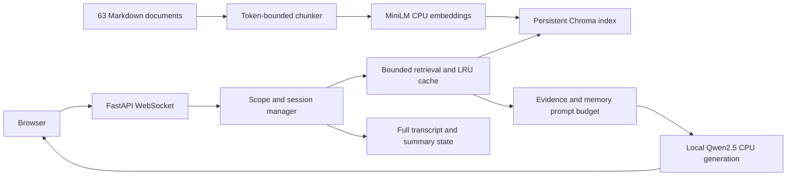

# ShopBot — Assignment 2: Offline Retrieval-Augmented Support

ShopBot answers product, fictional order, return, refund, exchange and shipping questions using local documents. It streams responses through FastAPI and Ollama to the existing light chat UI. Greetings are conversational; unrelated requests such as “What is the capital of Pakistan?” are redirected without answering.

## Architecture



There are no runtime agents, external search tools, or direct JSON business-answer lookups. Fixture helpers remain for validation and intent vocabulary. Every valid chat query attempts top-3 retrieval or a cached equivalent, including social and unrelated messages; those messages ignore retrieved facts. Missing assets return safe fallbacks.

## Requirements and setup

Tested on Windows with Python 3.13, CPU PyTorch 2.6.0, sentence-transformers 3.4.1, transformers 4.48.3 and Chroma 1.0.20. Use Python 3.11–3.13; Python 3.14 is not the validated dependency environment.

Run from the repository root in PowerShell:

```powershell
py -3.13 -m venv .venv
.venv/Scripts/Activate.ps1
python -m pip install -r requirements-lock.txt
python scripts/prepare_models.py
ollama pull qwen2.5:0.5b
python scripts/validate_corpus.py
python scripts/seed_data_check.py
python scripts/index_documents.py
ollama serve
uvicorn backend.main:app --host 127.0.0.1 --port 8000 --env-file .env
```

If Ollama already runs, skip `ollama serve`. Copy `.env.example` to `.env` only when needed; existing environment variables also work. Open http://localhost:8000. No frontend package manager or build is required.

Model preparation requires internet once. It records exact Hugging Face commit revisions in `models/manifest.json`. Runtime embedding/tokenizer loading uses `local_files_only=True`; Chroma receives explicit embeddings and disables anonymized telemetry. Ollama uses local weights, `num_gpu=0`, `num_ctx=4096`, and at most 512 output tokens. After preparation, run offline with:

```powershell
$env:HF_HUB_OFFLINE='1'
$env:TRANSFORMERS_OFFLINE='1'
python scripts/index_documents.py
uvicorn backend.main:app --host 127.0.0.1 --port 8000
```

The UI can fall back to its system font when the optional Google font is unavailable; chat code and styles are served locally.

## Corpus and incremental indexing

`data/corpus/` contains **63 source documents**: 18 product specifications, 18 distinct product FAQs, 15 fictional order summaries, nine policy topics, and three catalog price summaries. They derive from `data/products.json`, `data/orders.json`, and `data/policy.md`; the manifest records provenance, document ID, type and applicable SKU/order ID. These are snapshots, not live inventory or fulfillment data. Policy documents clarify that ShopBot cannot actually change orders, initiate refunds, send labels, or contact carriers.

The corpus produces **155 chunks**. MiniLM `all-MiniLM-L6-v2` supplies normalized 384-dimensional CPU embeddings; it is small enough for local execution. Its 256-wordpiece input limit motivates a 220-token chunk budget including title/entity prefixes, with 32-token overlap within oversized sections. Section boundaries are preserved where possible. Chunks preserve original text, prices, capitalization and line breaks using tokenizer character offsets; MiniLM decoding is never used to reconstruct evidence. Changing to this chunker requires `--rebuild`. Chunk IDs include document ID, ordinal and content hash.

Chroma provides local disk persistence, cosine search, metadata filters and incremental upserts. Indexing tracks document hashes, embedding revision, dimensions and chunker settings. Unchanged documents are not embedded again. Changed documents are embedded before mutation; obsolete chunks and deleted documents are removed. A persistent incomplete-build marker prevents serving an interrupted revision. Rebuild explicitly after an interrupted update or model/chunker change:

```powershell
# Stop the backend before updating the index.
python scripts/index_documents.py
python scripts/index_documents.py --rebuild
```

A process ownership lock prevents the server, benchmark and index writer from opening the same index simultaneously. An unchanged second run reports `unchanged=63`, with no duplicate inserts.

## Retrieval, context and memory

Queries request **top-k=3**, then discard similarity below **0.40**. The threshold was calibrated on the separate 30-question development set: the weakest positive scored 0.420 and strongest negative 0.346. Filtering or prompt limits can leave fewer than three usable chunks. Order queries use exact canonical order-ID metadata filters; other queries exclude order records. Recognized entity follow-ups use session metadata. Generated answers are never shared across sessions.

Blocking embeddings/search run in a dedicated two-worker executor, with at most eight admitted jobs and a 1.5-second deadline including queue time. Timed-out work retains its admission slot until the worker actually finishes. A fixed daemon-worker pool bounds shutdown to 200 ms; permanently stuck native work requires restarting the server process and cannot grow an unbounded queue. Retrieval results use a 128-entry LRU cache with a 300-second TTL; keys include query, entity/type filters, model/index revisions, top-k and threshold. Transient errors are not cached. Same-session turns are serialized; separate sessions remain independent.

The local Qwen tokenizer counts the complete chat-template prompt. A 4096-token context reserves 512 output tokens and 256 safety tokens, leaving 3328 prompt tokens. Instructions and current input take priority; evidence is capped at 1400 tokens, summary at 256, and recent complete exchanges at 800, with a final total check. Oversized mandatory input asks the user to shorten the question. Evidence is explicitly untrusted data: embedded commands do not acquire instruction authority; conflicting facts should be acknowledged. Conflicting structured price/stock/status/total fields for the same entity produce a deterministic clarification before generation; conflicts in free-form policy prose still depend on the model.

The full transcript remains intact in ignored `data/chat_history.json`. The prompt uses a separate working view. A summary cursor records older messages already summarized; summaries have a three-second timeout and trimming fallback. Summary, cursor, intent and last entities persist alongside messages. Legacy message-only histories still load. Reset clears all working memory and transcript for the session.

## Streaming API and failures

`/ws/chat` still accepts `{session_id, message}` and returns ordinary `token` frames followed by `done`, or a terminal `error`. `/api/health` retains existing keys and adds `rag.ready`. History/session REST routes retain their shapes.

Examples:

| Input / condition | Behavior |
| --- | --- |
| `hi` or `my name is Qadeer Raza` | Natural local-model greeting |
| `What is the capital of Pakistan?` | Store-domain redirect, no geography answer |
| `Track ORD-99999` | No matching order; no other order evidence |
| Weak or irrelevant evidence | Stream an explicit no-match notice, then a guarded conversational preference question |
| Missing model/index, embedding/search failure | Safe temporary-unavailability reply |
| Deadline or admission limit | Bounded fallback; other requests remain responsive |
| Excessive prompt size | Shorten-question clarification |

**Single Assignment 2 bonus: visible sources.** Grounded replies append a server-controlled `Sources:` footer through the same token frames. Only evidence actually included in the prompt is listed; paths are relative and deduplicated. Greetings, redirects and no-match replies have no footer.

## Tests and measurements

```powershell
python -m pytest
# Run retrieval benchmarks while the backend is stopped (index ownership).
python scripts/benchmark_rag.py --iterations 100 --concurrency 1 --output docs/benchmarks/rag-results-c1.json
python scripts/benchmark_rag.py --iterations 100 --concurrency 5 --output docs/benchmarks/rag-results-c5.json
# With the backend running, measure generation separately:
python scripts/benchmark_rag.py --generation-only --websocket ws://127.0.0.1:8000/ws/chat --concurrency 5 --output docs/benchmarks/generation-c5.json
```

Tests cover corpus limits, incremental shortening/deletion and embedding failures, exact order filters, cache revisions, timeout admission, full prompt limits, summary/reset/history compatibility, domain guards and streamed terminal frames. Unit tests replace external inference with deterministic doubles; measurements below use real MiniLM embeddings and the real disk index.

Measured October 10, 2026 on this Windows CPU machine. Full hardware/version/model-revision records and raw durations are in `docs/benchmarks/`.

| Measurement | One concurrent user | Five concurrent users |
| --- | ---: | ---: |
| Warm uncached retrieval p50 | 10.10 ms | 29.03 ms |
| Warm uncached retrieval p95 | 16.09 ms | 41.87 ms |
| Cached retrieval p95 | 0.0062 ms | 0.0048 ms |
| Model/index cold load | 3825 ms | 3788 ms |
| Holdout source/no-match checks | 30/30 | 30/30 |

Each run contains 100 uncached measurements plus 100 separately reported repeated-cache measurements. The unseen holdout contains 20 answerable and ten unanswerable queries. Source correctness accepts the expected specification or matching FAQ; it does not establish universal answer accuracy. Retrieval meets the sub-second target on this small corpus. The table above records the original 1.5B configuration. Generation/first-token timing is measured separately through real WebSocket traffic and can be much slower than retrieval; see `generation-c*.json`. The measured single-session first token was 7.57 seconds, with 10.46 seconds total. Five sessions completed in 7.45?14.61 seconds each; health requests during generation returned HTTP 200 in 57?375 ms. These timings include CPU generation queueing and are not retrieval latency.

## October 11 fixes and verification

The default model is now **qwen2.5:0.5b** for faster CPU replies. Set `SHOPBOT_MODEL=qwen2.5:1.5b` for more model capacity at higher latency. Startup warms the model and common system prompt in the background; `SHOPBOT_KEEP_ALIVE=30m` keeps weights resident between requests. Ordinary answers are capped at 256 generated tokens; catalog lists can use 512, both subject to `SHOPBOT_MAX_TOKENS`. Full prompt budgeting continues to reserve the configured maximum.

Shopping requests such as `i need cheap product`, `list if prodcut`, and `what can I buy under $20?` stay in scope. Common product typos are normalized for routing, retrieval, and generation. Broad shopping queries retrieve the three indexed catalog summaries with top-k=3. Price limits and category terms filter **retrieved rows**, sorted by price, before prompt assembly; runtime answers never read fixture JSON. Catalog replies stream exact rows from the retrieved evidence retained in the budgeted prompt, without model-generated facts. Ordinary browsing supplies five matching options; explicit `all` requests supply up to 18, and `cheapest` supplies one. Other support replies use local model generation. No-match turns stream a safe notice immediately and use the model only for a guarded preference question, preventing unsupported inventory claims. Exact unknown-order and temporarily unavailable retrieval replies remain deterministic.

Fresh Python 3.13 verification: **149 tests passed**, fixture validation passed, and all 63 corpus documents validated. An unchanged indexing run reported `unchanged=63` before the chunker rebuild. The rebuilt index has 155 chunks. Windows history reads and writes now share a reentrant lock, atomic replacement retries brief file locks, and `done` is sent after persistence. Live HTTP/static serving and history read/reset/deletion checks passed.

Measured on an Intel Core i5-1245U CPU, with the final model already loaded:

| Check | First token | Total reply |
| --- | ---: | ---: |
| Product battery question | 2.97 s | 3.58 s |
| Cheap product request | 35 ms | 46 ms |
| Product list with typo | 38 ms | 46 ms |
| Products under $20 | 34 ms | 40 ms |
| No matching telescope documents | 27 ms | 904 ms |

Five concurrent real WebSocket chats all ended with `done`, taking 3.39?6.36 seconds each. Updated five-user uncached retrieval p95 was **55.08 ms**, cached p95 **0.0062 ms**, with **30/30** holdout source/no-match checks. Earlier cold 1.5B inference took 11.45 seconds for the battery question; the direct installed-model comparison took 7.01 seconds for 1.5B versus 4.12 seconds for 0.5B. These are individual runs, not a guarantee or a controlled cold-to-cold comparison. Prompt/model caching, CPU load, history length and generation queueing affect latency.

Raw evidence: `docs/benchmarks/model-comparison.json`, `shopping-speed-after.json`, `rag-results-2026-10-11-c5.json`, `generation-2026-10-11-c5.json`, and `api-checks-2026-10-11.json`. Reproduce shopping checks with `python scripts/check_shopping_chat.py` while the backend is running; run `python scripts/compare_local_models.py` with the backend stopped.

## Limitations and submission

This is a fictional, unauthenticated classroom demo. Anyone who knows a fixture order ID can ask about it; deployable order access requires authentication. Small-model grounding and prompt-injection resistance remain probabilistic. Semantic search can miss paraphrases or choose incomplete evidence; the small labeled sets do not prove general accuracy. Runtime is single-process; JSON history and index ownership are unsuitable for multiple server workers. CPU generation can queue under concurrent load. Summaries can lose details, while the full transcript remains available. No fulfillment actions are performed.

Browser automation was unavailable in this execution environment. HTTP/static serving and real WebSocket behavior were checked; rendered desktop/mobile source-footer verification remains a manual check.

Submit this source directory through a private repository or ZIP. Include corpus, manifest, preparation/indexing scripts, evaluation sets, tests and documentation. Exclude `.env`, `.venv`, model weights, generated vector store, logs and conversation history. Rebuild generated assets using the commands above. AI prompt provenance is recorded in `docs/ai-prompts.md` for viva discussion.

## Team and attribution

| Name | Student ID | Original project role |
| --- | --- | --- |
| Sheharyar Ali | i230097 | Backend, conversation manager, prompt engineering |
| Qadeer Raza | i233059 | Frontend, LLM integration, testing and documentation |

Course: Natural Language Processing. Assignment 2 extends the Assignment 1 codebase. The supplied assignment states October 8, 2026 at 11:59 pm; no revised deadline is documented. All product/order/customer records are fictional.
