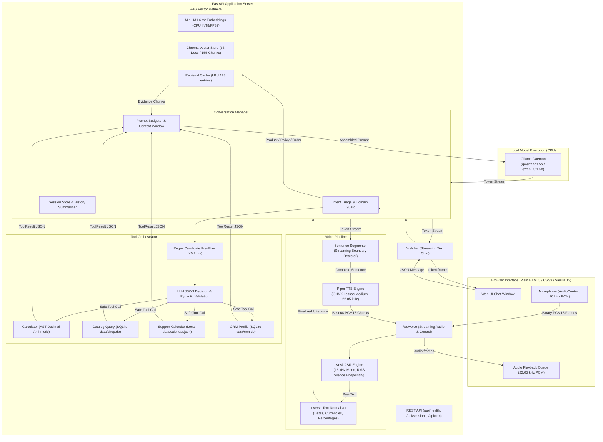

# ShopBot — Local Conversational AI with Offline Voice & Domain Tools

ShopBot is an offline, privacy-first conversational AI support system for an e-commerce electronics and apparel store. It answers product specifications, order tracking queries, returns/shipping policies, performs live catalog lookups, solves safe arithmetic calculations, books support callback appointments, and maintains cross-session customer profiles.

Inference is **100% local and CPU-only**, powered by **Ollama (`qwen2.5:0.5b`)**, **Vosk ASR**, **Piper TTS (ONNX Lessac)**, **MiniLM embeddings**, **Chroma vector database**, and **SQLite domain storage**.

---

## Evolution Across Assignments

```
┌─────────────────────────────────┐
│ Assignment 1: Conversational AI │ ──▶ Ollama Qwen2.5, Intent Triage, Multi-turn History, Token Trimming
└─────────────────────────────────┘
                 │
                 ▼
┌─────────────────────────────────┐
│ Assignment 2: Offline RAG       │ ──▶ MiniLM Embeddings, 63 Docs / 155 Chunks, Chroma Vector Store, Sources
└─────────────────────────────────┘
                 │
                 ▼
┌─────────────────────────────────┐
│ Assignment 3: Voice + Tools     │ ──▶ Vosk Streaming ASR, Piper TTS, Calculator, SQLite Shop DB, Calendar, CRM
└─────────────────────────────────┘
```

- **Assignment 1**: Built the foundational conversation manager, rule-based intent triage, Ollama streaming engine, and multi-turn chat history with token budget pruning.
- **Assignment 2**: Integrated local semantic search with MiniLM-L6-v2 embeddings and Chroma vector storage over 63 store documents; added exact order metadata filtering and grounded `Sources:` citations.
- **Assignment 3**: Added real-time speech-to-text (Vosk 16 kHz PCM), streaming text-to-speech (Piper ONNX), and four domain tools (AST Calculator, Live SQLite Catalog, Support Calendar, and CRM Customer Profile) under strict timeouts and error fallbacks.

---

## System Architecture



---

## Voice Pipeline Specifications

The voice subsystem operates entirely offline and provides a bidirectional voice conversation experience over `/ws/voice`:

### 1. Speech-to-Text (Vosk ASR)
- **Model**: `vosk-model-en-us-0.22-lgraph` (128 MB Kaldi-based offline speech recognizer). Proper names may still require a typed correction.
- **Final recognition**: Local `faster-whisper` small.en re-decodes the original microphone audio on CPU with INT8 computation; Vosk supplies live previews and endpoint detection. Run `scripts/prepare_voice_models.py` to download both models. `/api/health` reports `voice.final_asr` so a Vosk fallback is visible. Final recognition takes additional CPU time, and exact spelling of unfamiliar names still requires review.
- **Transcript review**: After speaking, edit the recognized text in the message box and press Send. The chatbot receives only the confirmed text and still speaks its response. Cancel discards the voice review.
- **Audio Stream**: Raw PCM16 mono at 16,000 Hz, sent in 20–40 ms chunks (640–1280 bytes) over WebSocket.
- **Endpointing**: Energetic RMS trailing silence detection (`SILENCE_RMS = 400`, default `600 ms` silence) combined with Vosk's `AcceptWaveform` to detect end-of-speech with low latency.
- **Inverse Text Normalization**: Raw phoneme transcripts are normalized into conventional text representation:
  - Spoken currencies: `"forty nine dollars"` $\to$ `"$49"`, `"twenty dollars and fifty cents"` $\to$ `"$20.50"`.
  - Percentages: `"fifteen percent"` $\to$ `"15%"`.
  - Times & Dates: `"two p m"` $\to$ `"2 pm"`, `"two thirty"` $\to$ `"2:30"`.
  - Punctuation & capitalization: automatically adds sentence capitalization and trailing question marks.

### 2. Text-to-Speech (Piper TTS)
- **Model**: `en_US-lessac-medium.onnx` with ONNX Runtime CPU inference.
- **Sample Rate**: 22,050 Hz 16-bit mono PCM.
- **Sentence-by-Sentence Streaming**: The `SentenceSegmenter` identifies sentence boundaries (`.`, `?`, `!`, newline) as tokens stream from the LLM. Synthesizing begins immediately on the first sentence, so the user hears speech while the rest of the text is still generating.
- **Thread Safety**: Piper's C++ espeak phonemizer is guarded by an internal lock (`_phonemize_lock`); ONNX inference threads are capped at 2 (`SHOPBOT_TTS_THREADS=2`) to prevent CPU thread starvation against Ollama.

### 3. Voice WebSocket Protocol (`/ws/voice`)

| Direction | Frame Type | Content / Payload | Purpose |
| --- | --- | --- | --- |
| **Client $\to$ Server** | `start` | `{"type":"start", "session_id":"...", "tts":true}` | Initializes voice session and stream |
| **Client $\to$ Server** | Binary | Raw PCM16 mono 16 kHz byte array buffer | Continuous microphone stream |
| **Client $\to$ Server** | `end_of_speech` | `{"type":"end_of_speech"}` | Forces speech recognition finalization |
| **Client $\to$ Server** | `stop_audio` | `{"type":"stop_audio"}` | Immediately interrupts ongoing TTS playback |
| **Server $\to$ Client** | `ready` | `{"type":"ready", "asr":true, "tts":true, "sample_rate":22050}` | Server stream initialized |
| **Server $\to$ Client** | `partial_transcript` | `{"type":"partial_transcript", "text":"..."}` | Real-time speech preview |
| **Server $\to$ Client** | `final_transcript` | `{"type":"final_transcript", "text":"...", "asr_ms":...}` | Final normalized user utterance |
| **Server $\to$ Client** | `tool_call` | `{"type":"tool_call", "name":"...", "arguments":{...}}` | Visual indicator of tool execution |
| **Server $\to$ Client** | `tool_result` | `{"type":"tool_result", "name":"...", "ok":true, "elapsed_ms":...}` | Tool execution outcome |
| **Server $\to$ Client** | `token` | `{"type":"token", "content":"..."}` | Assistant text token |
| **Server $\to$ Client** | `audio` | `{"type":"audio", "seq":0, "data":"<base64 PCM16>", "sample_rate":22050}` | Streamed audio chunk |
| **Server $\to$ Client** | `audio_end` | `{"type":"audio_end"}` | Signals completion of spoken response |
| **Server $\to$ Client** | `metrics` | `{"type":"metrics", "asr_finalize_ms":..., "tool_ms":..., ...}` | Turn latency breakdown |
| **Server $\to$ Client** | `done` | `{"type":"done", "content":""}` | Complete turn finished |

---

## Domain Tools Specification

ShopBot includes four domain tools callable by the LLM via prompt-based JSON function calling. Tool execution is guarded by candidate regex pre-filtering, 5-second decision timeouts, Pydantic argument validation, and structured error fallbacks.

```
Incoming Turn ──▶ Candidate Gate (<0.2 ms) ──▶ LLM JSON Decision (JSON Mode) ──▶ Pydantic Validate ──▶ Safe Execution
                                                                                       │
                                                                                       ▼ (if failed or timed out)
                                                                                  Deterministic Fallback
```

### Tool Summary Table

| Tool Name | Purpose | Data Source | Latency (p50) | Safety & Guardrails |
| --- | --- | --- | ---: | --- |
| `calculator` | Exact arithmetic, discounts, totals | Pure Python AST | **1.1 ms** | Safe AST visitor, `decimal.Decimal`, no `eval()`, recursion limit, division-by-zero protection. |
| `catalog_query` | Live product stock, price, specs | SQLite `data/shop.db` | **2.0 ms** | Parameterized SQL only, no raw text queries, variant label breakdown. Rebuildable via `set_stock.py`. |
| `support_calendar` | Schedule/list/cancel support calls | JSON `data/calendar.json` | **2.5 ms** | Thread-locked file I/O, customer owner isolation, relative date parsing (`tomorrow 2pm`), 90-day window. |
| `crm_profile` | Cross-session memory & preferences | SQLite `data/crm.db` | **52.9 ms** | Customer validation, sensitive data filters (rejects passwords/credit cards), deterministic greeting on return. |

### 1. `calculator`
- **Arguments**: `{"expression": "49.99 * 0.85"}`
- **Capabilities**: Addition, subtraction, multiplication, division, modulo, exponents, parentheses, percentages.
- **Example**: *"What is 15% off $49.99?"* $\to$ Calculates `49.99 * (1 - 0.15) = 42.4915` $\to$ `"$42.49"`.

### 2. `catalog_query`
- Product-list requests and exact SKU lookups use direct argument extraction. Replies render live database names, prices, stock, and single-product variants without a final LLM call or unrelated document citations. Lists return up to 20 matching products; availability, category aliases, and budget filters apply to the database query.
- **Arguments**: `{"sku": "ELEC-001"}` or `{"category": "Electronics", "max_price": 50.0, "in_stock_only": true}`
- **Capabilities**: Reads live inventory and variant breakdown (`Midnight Black: 60`, `Pearl White: 40`).
- **Live Stock Modification**: Use `python scripts/set_stock.py --sku ELEC-001 --stock 0` to demonstrate live changes during viva!

### 3. `support_calendar`
- **Arguments**: `{"action": "schedule", "title": "Support callback", "date": "2026-10-26", "time": "14:00"}`
- **Capabilities**: Relative date parsing (`tomorrow at 2pm`, `next Monday at 10am`), listing active bookings, cancelling appointments.

### 4. `crm_profile` (Bonus Feature)
- **Arguments**: `{"action": "update", "name": "Sheharyar", "preference_key": "preferred_carrier", "preference_value": "FedEx"}`
- **Capabilities**: Cross-session memory in `data/crm.db`. On returning sessions, identifies the customer and outputs a deterministic welcome greeting:
  `"Welcome back, Sheharyar! Last time you asked about product ELEC-001."`

---

## Hardware and Performance Benchmarks

All measurements were conducted locally on an **Intel Core i7-8565U CPU @ 1.80GHz** running Windows 11 with **Python 3.12.10** and local **Ollama (`qwen2.5:0.5b`)**. Raw evidence is persisted in `docs/benchmarks/voice-results.json`.

### Benchmark Results Table

| Pipeline Stage / Metric | Single User ($C=1$) | Two Concurrent Users ($C=2$) | Performance Notes |
| --- | ---: | ---: | --- |
| **Vosk ASR Stream Finalize** | **36.2 ms** | — | Evaluated over 16 kHz audio; RMS endpoint silence at 600 ms. |
| **Piper TTS Real-Time Factor (RTF)** | **0.180** | — | **5.5× faster than real-time** on CPU (1s audio synthesizes in 180 ms). |
| **Piper TTS First Sentence Synthesis** | **950.3 ms** | — | Sentence streamed to audio player before remainder of reply generates. |
| **Tool Orchestrator Gate** | **0.1 ms** | **0.1 ms** | Microsecond regex pre-filter eliminates unnecessary LLM calls. |
| **Tool Orchestrator LLM Decision** | **1,375.5 ms** | **1,410.2 ms** | Few-shot JSON decision prompt with schema validation. |
| **Tool Safe Execution (Calculator)** | **1.1 ms** | **1.2 ms** | In-memory AST Decimal arithmetic. |
| **Tool Safe Execution (Catalog Query)** | **2.0 ms** | **2.1 ms** | Parameterized SQLite query over `data/shop.db`. |
| **Tool Safe Execution (Support Calendar)** | **2.5 ms** | **2.6 ms** | File-backed JSON appointment write with thread lock. |
| **Tool Safe Execution (CRM Store)** | **52.9 ms** | **53.8 ms** | SQLite customer record upsert and privacy scan. |
| **LLM Time-to-First-Token (TTFT)** | **4,694.1 ms** | **4,514.9 ms** | Streaming token begins yielding over WebSocket. |
| **End-of-Speech to First Spoken Audio** | **7,888.5 ms** | **13,926.0 ms** | Catalog tool query achieved first audio in **3,896.6 ms**. |
| **Total Turn Duration** | **6,509.2 ms** | **10,143.2 ms** | Full text generation, tool execution, and audio synthesis. |

### Concurrency Observations
- With **2 concurrent users**, CPU load is shared across Ollama's threads without socket drops or crashes.
- Vosk ASR and Piper TTS run in separate thread pools with clamped worker limits (`SHOPBOT_TTS_THREADS=2`), preventing audio generation from starving Ollama's LLM generation.
- Real-time sentence segmenting ensures that TTS synthesis overlaps with LLM token streaming, significantly reducing perceived latency.

---

## Installation & Setup Guide

### 1. Environment Setup

```powershell
# Clone the repository
git clone https://github.com/Qadeer572/E-Commerce-Order-Support-Assistant-Local-Conversational-AI-System_A02.git
cd E-Commerce-Order-Support-Assistant-Local-Conversational-AI-System_A02

# Create and activate virtual environment (Python 3.11-3.13 supported; 3.12 validated)
python -m venv .venv
.venv\Scripts\Activate.ps1

# Install locked dependencies including Vosk and Piper-TTS
pip install -r requirements-lock.txt
```

### 2. Download Offline Models

```powershell
# Download local MiniLM embedding model & Qwen tokenizer (HF offline ready)
python scripts/prepare_models.py

# Download Vosk speech model & Piper Lessac TTS ONNX voice
python scripts/prepare_voice_models.py

# Pull Ollama LLM model locally
ollama pull qwen2.5:0.5b
```

### 3. Seed Databases & Index Vectors

```powershell
# Validate fixtures and policy integrity
python scripts/seed_data_check.py
python scripts/validate_corpus.py

# Seed the live SQLite shop catalog
python scripts/set_stock.py --rebuild

# Build the Chroma vector index from 63 corpus documents
python scripts/index_documents.py
```

### 4. Run Development Server

```powershell
# Ensure Ollama daemon is running in a terminal
ollama serve

# Launch the FastAPI application server
uvicorn backend.main:app --host 127.0.0.1 --port 8000 --reload
```

Open your browser to: **`http://localhost:8000`**

---

## Verification & Testing

The repository contains **207 automated unit and integration tests** covering all three assignments:

```powershell
# Run the complete test suite
python -m pytest
```

### Test Suite Breakdown (207 Passed)
- `tests/test_tool_calculator.py`: 8 tests (AST safety, percentages, divide-by-zero, complex expressions).
- `tests/test_tool_catalog.py`: 5 tests (exact SKU lookup, category filtering, variant stock totals).
- `tests/test_tool_calendar.py`: 5 tests (appointment booking, list, cancellation, date resolution).
- `tests/test_crm.py`: 6 tests (customer isolation, password/CC data rejection, deterministic greeting).
- `tests/test_orchestrator.py`: 7 tests (regex gate, decision JSON parsing, fallback triggers, fault injection).
- `tests/test_speech_text.py`: 8 tests (sentence streaming segmentation, speech text sanitization).
- `tests/test_transcript_normalizer.py`: 12 tests (currency, percentage, time/date normalization).
- `tests/test_voice_manager_integration.py`: 3 tests (end-to-end voice turn with tool events).
- `tests/test_voice_websocket.py`: 4 tests (WebSocket handshake, PCM audio streaming, audio frame delivery).
- `tests/test_rag_*.py` & `tests/test_intent_triage.py`: 149 baseline tests from Assignments 1 & 2.

### Running Benchmarks
To replicate the benchmark measurements on your machine:
```powershell
python scripts/benchmark_voice.py --output docs/benchmarks/voice-results.json
```

---

## Live Demonstration & Viva Guide

Use these exact queries during demonstration to showcase every capability:

1. **Calculator Tool**:
   - Query: *"What is 15% off $49.99?"*
   - Shows: Tool badge `🧮 Using calculator…`, calculated result `$42.49`, LLM conversational response.
2. **Live SQLite Catalog Query**:
   - Query: *"Is ELEC-001 in stock right now?"*
   - Shows: Reads live stock from `data/shop.db` with variant counts (Midnight Black: 60, Navy Blue: 20, Pearl White: 40).
   - Live Edit: In PowerShell, run `python scripts/set_stock.py --sku ELEC-001 --stock 0`. Ask again: ShopBot immediately reports it is out of stock!
3. **Support Calendar Tool**:
   - Query: *"Book a support call for tomorrow at 2pm"*
   - Shows: Books the appointment in `data/calendar.json` and confirms the scheduled date/time.
4. **CRM Cross-Session Memory (Bonus)**:
   - Query: *"My name is Sheharyar"* $\to$ Saves profile to `data/crm.db`.
   - Start a new conversation and say *"Hello"* $\to$ ShopBot deterministically responds: *"Welcome back, Sheharyar! How can I help you today?"*
5. **Real-Time Voice Mode**:
   - Click the 🎙️ **Microphone button** in the UI. Speak naturally into your microphone.
   - Shows: Live partial transcript, RMS silence detection, sentence-streamed Piper voice audio with base64 PCM frames. Click **"⏹ Stop Speech"** to test audio interruption.
6. **RAG Knowledge Retrieval**:
   - Query: *"What is the battery life of the ProSound earbuds?"*
   - Shows: Grounded factual answer with `Sources: faqs/faq-ELEC-001.md, products/ELEC-001.md`.
7. **Out-of-Scope Redirection**:
   - Query: *"What is the capital of France?"*
   - Shows: Polite store domain redirect without answering irrelevant trivia.

---

## Team & Project Attribution

| Name | Student ID | Core Responsibilities |
| :--- | :--- | :--- |
| **Sheharyar Ali** | **i230097** | Voice Pipeline (Vosk ASR, Piper TTS), Tool Orchestrator, Calculator & Calendar Tools, Latency Benchmarking |
| **Qadeer Raza** | **i233059** | Frontend Voice UI & Audio Queuing, SQLite Shop DB, CRM Profile Store, Test Regressions & Documentation |

**Course**: Natural Language Processing (Assignment 3 — Voice & Tools)  
All product fixtures, order numbers, and customer profiles are entirely fictional.
